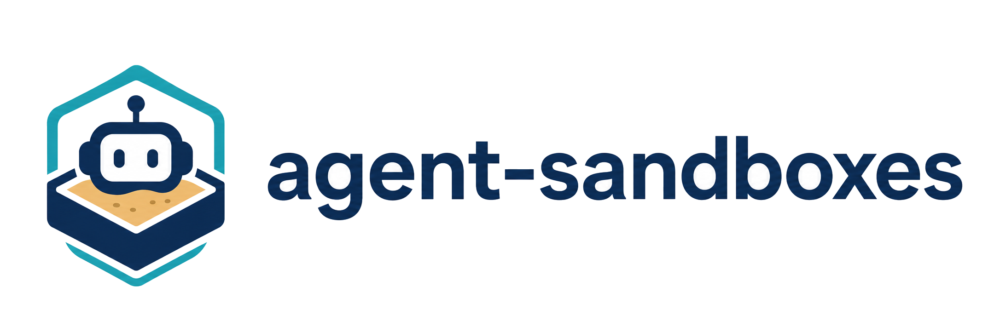

<p align="center">
  <picture>
    <source media="(prefers-color-scheme: dark)" srcset="docs/images/agent-sandboxes-wide-dark.png" />
    
  </picture>
</p>

<p align="center">
  <b>Sandboxed execution environment for AI coding agents</b>
</p>

Works with Claude Code, OpenAI Codex CLI, and OpenCode. GitHub Copilot CLI and the
xAI Grok CLI are not yet available in v3.

Each agent session runs in its own Kata Containers microVM inside a dedicated
appliance VM. All of its traffic goes through a per-session gateway that
enforces a default-deny egress allowlist and holds the agent's credentials:
the agent sees placeholders, and the gateway puts the real values into
requests to the hosts they are bound to. Your repositories are copied into
the VM and synced back through a gate that withholds changes to executable
configuration. Design intent and operator guidance are in
[PRINCIPLES.md](PRINCIPLES.md).

> **v3 is in development on the `v3` branch.** Install it from a locally
> built image (`sandbox install --dev-image`); signed release images and
> `sandbox upgrade` are not built yet. Coming from v2? See
> [Upgrading from v2](docs/how-to/upgrading-from-v2.md).

## When to use this

Use this sandbox when you want an AI agent to run shell commands, edit
files, and reach the network on your behalf, **and you don't fully trust
what it might do**. The agent can only reach the domains its tier allows,
never sees your `~/.ssh/`, `~/.aws/`, or `~/.kube/`, never holds your
login tokens, and anything it breaks stays inside a microVM you can stop
with `sandbox stop`.

You probably **don't** need this if you're just chatting with an LLM
through its hosted UI, or running the official CLI yourself on a repo
you'd let any colleague edit. The sandbox exists for the "agent
autonomously executes things" case (code generation, infra work,
multi-step tasks) where a mistake or jailbreak could touch real systems.

Before your first session, skim **[PRINCIPLES.md](PRINCIPLES.md)**. It covers
what this sandbox defends against, what it doesn't, and your accountability
as the operator.

## Quick start

macOS 15+ on Apple M3 or later, and Linux with KVM. Windows is not available in v3 yet.
The full walkthrough is [Your first session](docs/tutorials/first-session.md);
installing is covered in [Installing](docs/how-to/installing.md).

Coming from v2? `bin/sandbox` in this checkout is still v2's bash script, and v2's
setup put it on your PATH: read [Upgrading from v2](docs/how-to/upgrading-from-v2.md)
first.

```bash
# 1. Build the host binary (Go 1.27) into a directory early on your PATH.
(cd go && go build -o ~/bin/sandbox ./cmd/sandbox)

# 2. Install the appliance VM from a locally built image.
sandbox install --dev-image ~/sandbox-appliance.raw

# 3. Check it.
sandbox doctor

# 4. Build the agent images in the VM (once; about 10 minutes).
sandbox rebuild --agent base && sandbox rebuild --agent claude

# 5. Sign Claude Code in: run 'claude setup-token' on this machine, then
sandbox onboard --agent claude

# 6. Launch a session on a repository.
sandbox run --agent claude --tier 2 --repo ~/repos/my-project

# List sessions, view logs, resume a keep-alive session.
sandbox list
sandbox logs   ses-20261126-143022-a7b3
sandbox resume ses-20261126-143022-a7b3
```

## Tiers

| Tier | Workspace                  | Requirements                                       |
|------|----------------------------|----------------------------------------------------|
| 1    | optional `--repo`          | none; history is kept for the session only         |
| 2    | `--repo` (repeatable)      | each must be a git repository                      |
| 3    | `--repo` (repeatable)      | `--repo` and `--infra-token` (with `--infra-endpoint`) |

Each tier widens the egress allowlist. Conversation history is kept per agent,
tier, and repository from tier 2 up. Full per-tier domain lists and the agent
allowlists are in [Agents & tiers](docs/reference/agents-and-tiers.md).

## Documentation

Full docs live in **[docs/](docs/index.md)**. Quick links:

**Get started**: [Installing](docs/how-to/installing.md) ·
[Your first session](docs/tutorials/first-session.md) ·
[Signing agents in](docs/how-to/onboarding-agents.md) ·
[Upgrading from v2](docs/how-to/upgrading-from-v2.md)

**How-to**: [Profiles & overlays](docs/how-to/profiles-and-overlays.md) ·
[Persistent domains & block list](docs/how-to/persistent-domains.md) ·
[Secrets](docs/how-to/secrets.md) ·
[Egress (L7) rules](docs/how-to/egress-rules.md) ·
[MCP & service deps](docs/how-to/mcp-and-dependencies.md) ·
[Tier 3 infra credentials](docs/how-to/tier3-infra-credentials.md) ·
[Resuming sessions](docs/how-to/resuming-sessions.md) ·
[TLS-intercept proxies](docs/how-to/tls-intercept-proxies.md) ·
[Rebuilding images](docs/how-to/rebuilding-images.md) ·
[Uninstalling](docs/how-to/uninstalling.md)

**Reference**: [CLI](docs/reference/cli.md) ·
[Agents & tiers](docs/reference/agents-and-tiers.md) ·
[Configuration](docs/reference/configuration.md) ·
[Audit logs](docs/reference/audit-logs.md) ·
[Platform requirements](docs/reference/platform-requirements.md)

**Understand**: [Security model](docs/explanation/security-model.md) ·
[Architecture](docs/explanation/architecture.md) ·
[How this compares](docs/explanation/comparisons.md) ·
[PRINCIPLES.md](PRINCIPLES.md)

**Stuck?** [Troubleshooting](docs/explanation/troubleshooting.md)

## License

Copyright 2026 Samaritan's Purse

The code authored by Samaritan's Purse in this repository is licensed under
the Apache License, Version 2.0. See the [LICENSE](LICENSE) file for the full
terms and the [NOTICE](NOTICE) file for third-party attributions.
